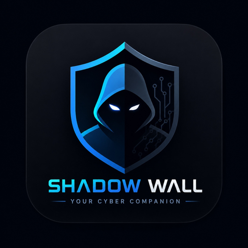

<div align="center">


  

  <br/><br/>

  

  # 🛡️ ShadowWall AI
  ### Intelligent Mobile Cyber Safety Companion Using Context-Aware AI

  [](https://flutter.dev)
  [](https://dart.dev)
  [](https://aistudio.google.com/)
  [](https://firebase.google.com/)
  [](https://talsec.app/)
  [](.github/workflows/build-apk.yml)
  [](LICENSE)

  <p align="center">
    <b>A next-generation, zero-trust mobile defense suite designed to protect everyday users from advanced social engineering, deceptive UPI payment fraud, rogue Wi-Fi access points, malware sideloads, and zero-day threats using on-device machine learning and context-aware generative AI.</b>
  </p>

  [Features](#-key-features) • [Architecture](#-system-architecture) • [Getting Started](#-getting-started) • [Environment Setup](#-environment-configuration) • [Building for Production](#-building-for-production) • [Security & Privacy](#-security--privacy-by-design)

</div>

---

## 📌 Overview

As mobile computing becomes the primary gateway for personal communications and digital transactions, cyber threats targeting mobile users have escalated in sophistication. Attackers exploit cognitive vulnerabilities through **UPI payment tampering**, **phishing URLs**, **covert background spyware permissions**, **QRLJacking**, and **rogue Wi-Fi networks**.

**ShadowWall AI** bridges the gap between complex enterprise-grade cybersecurity and accessible consumer protection. By unifying on-device heuristics, hardware-backed cryptography, Google ML Kit on-device vision, and multi-model AI threat intelligence (Google Gemini Flash), ShadowWall AI provides real-time, context-sensitive defense right on your Android and iOS devices.

---

## 🚀 Key Features

### 1. 🤖 Context-Aware AI Security Companion
* **Multi-Engine Intelligence**: Seamlessly connects to **Google Gemini Flash / Flash-Lite** for deep threat reasoning and triage.
* **Offline Fallback Knowledge Core**: Functions completely offline when internet connectivity is cut, providing instant incident response guidance for active hacks, SIM swaps, account hijacks, and malware alerts.
* **Natural Cybersecurity Dialogue**: Users can ask complex defense questions, analyze suspicious text messages, or request step-by-step remediation protocols.

### 2. 📦 Deep APK & Sideload Analyzer
* **Static Manifest Inspection**: Extracts and parses the `AndroidManifest.xml` of sideloaded `.apk` files before installation.
* **Risk Score Heuristics**: Detects suspicious intent filters, exported activities, hidden background services, and suspicious dynamic code loading flags.
* **Dangerous Permissions Audit**: Highlights intrusive permissions like `SYSTEM_ALERT_WINDOW`, `BIND_ACCESSIBILITY_SERVICE`, and `REQUEST_INSTALL_PACKAGES`.

### 3. 🔍 Multi-Engine URL Reputation Scanner
* **Multi-Layer Analysis**: Integrates Google Safe Browsing, VirusTotal intelligence, and local heuristic analysis.
* **Homograph & Punycode Detection**: Flags deceptive phishing domains using lookalike Cyrillic characters or zero-width spaces.
* **Redirection & Payload Audit**: Traces URL redirects and detects obfuscated executable links before the browser is opened.

### 4. 📸 Smart Screenshot & UPI Scam Analyzer
* **On-Device OCR**: Powered by **Google ML Kit Text Recognition** for immediate on-device processing without uploading private images to external servers.
* **Deceptive Payment Slip Verification**: Identifies fake UPI transaction screenshots (Google Pay, PhonePe, Paytm) fabricated using counterfeit receipt generators.
* **Social Engineering Detector**: Flags urgency markers, fraudulent lottery claims, and fake KYC suspension warnings.

### 5. 📶 Wi-Fi Guardian & Network Defense
* **Rogue AP Detection**: Detects open/unencrypted Wi-Fi hotspots, evil-twin candidates, and suspicious SSID configurations.
* **Gateway & DNS Integrity**: Tests for DNS hijacking, unencrypted captive portals, and gateway spoofing.
* **Public Network Precautions**: Offers actionable defense advice including VPN recommendations and Wi-Fi isolation.

### 6. 🛡️ Device Integrity & FreeRASP Shield
* **Root & Jailbreak Detection**: Real-time auditing for unlocked bootloaders, superuser binaries, Magisk, and Su daemons.
* **Runtime Defense (FreeRASP)**: Defends against debugger attachments, dynamic instrumentation (Frida, Xposed), and hook frameworks.
* **Developer Environment Audit**: Warns if ADB debugging or mock locations are left enabled in production environments.

### 7. 🔐 Hardware-Backed Encrypted Secret Locker
* **AES-256 Encryption**: Encrypts sensitive personal notes, recovery seeds, private credentials, and documents.
* **Hardware Keystore Integration**: Uses `flutter_secure_storage` backed by Android KeyStore and iOS Keychain.
* **Biometric Authentication**: Enforces Fingerprint / Face ID authentication before unlocking the vault.

### 8. 🔑 Password Guardian & Breach Auditor
* **Cryptographic Entropy Calculation**: Evaluates passwords using Shannon entropy metrics, character distribution, and dictionary checks.
* **Breach Telemetry**: Checks master password hashes securely against compromised credential dumps via k-Anonymity APIs.
* **Offline Password Generator**: Generates cryptographically secure, high-entropy passphrases on-demand.

### 9. 🩺 Granular Permission Doctor
* **High-Risk Permission Matrix**: Categorizes app permissions by risk level (Camera, Microphone, Background Location, SMS, Accessibility).
* **Stealth App Identification**: Flags background apps holding sensitive hardware access while displaying no foreground notification.
* **One-Tap System Settings**: Direct shortcuts into system settings to revoke unneeded privileges instantly.

### 10. 🎯 Malicious QR Code Guardian
* **Instant Barcode Scanner**: Powered by Google ML Kit Barcode Scanning.
* **QRLJacking Defense**: Analyzes embedded QR payloads, deep links, Wi-Fi auto-connect strings, and URI schemes before execution.
* **Preview Sanitization**: Shows a decoded security audit before opening browser links or launching external apps.

### 11. 👥 Community Threat Intelligence & News
* **Crowdsourced Threat Feed**: Real-time community alerts where users can report new phishing phone numbers, scams, and fraudulent campaigns.
* **Verified Cybersecurity News**: Curated live security feeds summarizing emerging zero-day vulnerabilities, mobile malware strains, and defensive best practices.

### 12. 📊 Threat Analytics & Cyber Forensics
* **Interactive Threat Metrics**: Visualized with high-performance `fl_chart` curves, threat category breakdowns, and safety indices.
* **Historical Audit Log**: Maintains a sandboxed local database of previous scans, identified vulnerabilities, and remediation actions.

### 13. 📄 Exportable Forensic Audit PDF Reports
* **Enterprise-Ready Reports**: Generates detailed, professional PDF security audit reports formatted with high-definition styling, vulnerability timelines, and executive summaries using the `pdf` and `printing` engine.

### 14. 🎓 Interactive Cyber Safety Academy
* **Gamified Defense Modules**: Interactive simulation walk-throughs covering phishing, SIM swapping, QR fraud, and ransomware.
* **Knowledge Check Quizzes**: Tests and rewards user cybersecurity awareness.

---

## 🏛 System Architecture

ShadowWall AI follows clean architectural principles with strict separation of concerns, reactive state management via **Riverpod**, and a local-first privacy posture:

```
┌────────────────────────────────────────────────────────────────────────┐
│                        PRESENTATION LAYER                              │
│   Flutter 3.29+  │  Cyber Design System  │  GoRouter  │  FL Chart      │
└───────────────────────────────────┬────────────────────────────────────┘
                                    │
┌───────────────────────────────────▼────────────────────────────────────┐
│                      APPLICATION & STATE LAYER                         │
│   Flutter Riverpod 2.5+ State Notifiers & Reactive Providers           │
└───────────────────┬───────────────────────────────┬────────────────────┘
                    │                               │
┌───────────────────▼─────────────┐   ┌─────────────▼────────────────────┐
│      ON-DEVICE INTELLIGENCE     │   │      CLOUD SECURITY SERVICES     │
│  • Google ML Kit OCR & Barcodes │   │  • Google Gemini Flash (REST)    │
│  • FreeRASP Runtime Defense     │   │  • Google Safe Browsing API      │
│  • Biometric local_auth         │   │  • VirusTotal Threat Intel       │
│  • Offline Security Fallback    │   │  • Firebase Auth & Firestore     │
└───────────────────┬─────────────┘   └─────────────┬────────────────────┘
                    │                               │
┌───────────────────▼───────────────────────────────▼────────────────────┐
│                          DATA & STORAGE LAYER                          │
│   Drift (SQLite)  │  Flutter Secure Storage (AES-256)  │  SharedPrefs  │
└────────────────────────────────────────────────────────────────────────┘
```

---

## 📂 Project Directory Structure

```
shadowwall_ai/
├── .github/
│   └── workflows/
│       └── build-apk.yml          # Automated CI/CD for APK & AAB builds
├── android/                       # Native Android configuration & Gradle build scripts
├── assets/
│   └── images/                    # Branding graphics, icons, and logos
├── docs/
│   ├── PLAY_STORE_SUBMISSION_GUIDE.md  # Complete Play Store compliance guide
│   └── PRIVACY_POLICY.md               # User privacy agreement & data policy
├── lib/
│   ├── core/                      # Global theme, router, database, and configurations
│   │   ├── config/                # Environment loader (EnvConfig)
│   │   ├── database/              # Drift SQLite models & tables
│   │   ├── router/                # Declarative routing with GoRouter
│   │   ├── theme/                 # Cyberpunk dark mode design tokens & typography
│   │   └── utils/                 # Logging, validators, and helpers
│   ├── features/                  # Domain modules (Clean Feature-First Architecture)
│   │   ├── ai_assistant/          # Gemini Live AI & offline knowledge base
│   │   ├── apk_analyzer/          # Static APK inspection engine
│   │   ├── auth/                  # Firebase & Biometric authentication
│   │   ├── cyber_reports/         # High-resolution PDF security report generation
│   │   ├── dashboard/             # Threat score meter & telemetry cockpit
│   │   ├── device_security/       # Root, jailbreak & FreeRASP auditor
│   │   ├── learning_center/       # Interactive cyber safety academy
│   │   ├── password_guardian/     # Password entropy & breach auditor
│   │   ├── permission_doctor/     # App permission analyzer & manager
│   │   ├── qr_guardian/           # QR barcode scanner & threat parser
│   │   ├── scam_community/        # Crowdsourced scam feed & security news
│   │   ├── screenshot_analyzer/   # ML Kit OCR fraud & fake payment detector
│   │   ├── secret_locker/         # AES-256 hardware encrypted vault
│   │   ├── settings/              # Policy config, theme & API key manager
│   │   ├── threat_analytics/      # Incident analytics & charts
│   │   ├── url_scanner/           # Domain reputation & homograph auditor
│   │   └── wifi_guardian/         # Wi-Fi network auditor & rogue AP detector
│   ├── firebase_options.dart      # Firebase client configuration
│   └── main.dart                  # Application initialization entrypoint
├── test/                          # Unit and widget test suite
├── .env.example                   # Environment configuration template
└── pubspec.yaml                   # Dependencies & asset declarations
```

---

## 🛠 Getting Started

### Prerequisites

* [Flutter SDK](https://flutter.dev/docs/get-started/install) (`>= 3.22.0`, recommended `3.29+`)
* [Dart SDK](https://dart.dev/get-dart) (`>= 3.4.0 < 4.0.0`)
* [Java Development Kit (JDK)](https://adoptium.net/) (Java 17 recommended for Android Gradle)
* [Android Studio](https://developer.android.com/studio) or [VS Code](https://code.visualstudio.com/) with Flutter extension
* An Android device or emulator running **Android 7.0+ (API level 24+)**

### 1. Clone the Repository

```bash
git clone https://github.com/Harivarshan1026/shadowwall_ai.git
cd shadowwall_ai
```

### 2. Install Dependencies

```bash
flutter pub get
```

### 3. Environment Configuration

Copy the template `.env.example` file to create your local `.env`:

```bash
cp .env.example .env
```

Open `.env` and insert your API keys:

```env
# Google Gemini AI Key (REQUIRED for Live AI Companion & Threat Analysis)
# Get a free key at: https://aistudio.google.com/app/apikey
GEMINI_API_KEY=your_gemini_api_key_here
GEMINI_MODEL=gemini-flash-lite-latest

# Optional Third-Party Threat Intelligence Keys
SAFE_BROWSING_API_KEY=your_google_safe_browsing_key_here
VIRUSTOTAL_API_KEY=your_virustotal_api_key_here
```

> **Note**: Even without third-party API keys configured, ShadowWall AI's offline rule engine, local OCR analyzer, static APK analyzer, hardware secret locker, and device security audits will function completely out of the box!

### 4. Run the App

```bash
# Debug mode
flutter run

# Or target a specific connected Android device
flutter run -d <device-id>
```

---

## 🔒 Environment & Secret Isolation

ShadowWall AI is engineered with strict secret isolation:
* **Zero Hardcoded Secrets**: Production secrets and personal API tokens are strictly ignored in `.gitignore` and are never committed to version control.
* **Multi-Tier Resolution**: `EnvConfig` resolves keys through a graceful fallback chain:
  1. **Runtime In-App User Overrides** (encrypted in local SharedPreferences)
  2. **Compile-time flags** (`--dart-define=GEMINI_API_KEY=...`)
  3. **Local `.env` file** (excluded from Git)
  4. **Built-in Offline Heuristic Fallback Engine**
* **Safe CI/CD Integration**: The GitHub Actions pipeline injects credentials via GitHub Repository Secrets into compile-time flags without modifying codebase files.

---

## 🏗 Building for Production

### Android Release APK

```bash
flutter build apk --release \
  --dart-define=GEMINI_API_KEY="YOUR_KEY" \
  --dart-define=SAFE_BROWSING_API_KEY="YOUR_KEY" \
  --dart-define=VIRUSTOTAL_API_KEY="YOUR_KEY"
```

The output will be located at `build/app/outputs/flutter-apk/app-release.apk`.

### Google Play App Bundle (AAB)

To sign and build an Android App Bundle for Google Play Store submission:

1. Configure your upload keystore in `android/key.properties` (see `android/key.properties.example`).
2. Run:
   ```bash
   flutter build appbundle --release
   ```
3. Locate the generated bundle at `build/app/outputs/bundle/release/app-release.aab`.

---

## 🧪 Testing

Execute the automated test suite to ensure system integrity:

```bash
# Run all unit and feature tests
flutter test

# Run a specific module test
flutter test test/features/apk_analyzer/apk_analyzer_test.dart
```

---

## 🛡 Security & Privacy by Design

ShadowWall AI adheres to strict data privacy principles:
* **No Telemetry Tracking**: We do not sell, harvest, or transmit your device data.
* **On-Device First**: Image OCR (UPI fraud detection), permission auditing, and APK decompilation happen entirely on the local device hardware.
* **Encrypted at Rest**: Vault items in the Secret Locker are encrypted using **AES-256** with encryption keys managed by the Android KeyStore / iOS Secure Enclave.
* **Compliance**: Complete privacy disclosures and permissions usage documentation are detailed in [`docs/PRIVACY_POLICY.md`](docs/PRIVACY_POLICY.md).

---

## 🤝 Contributing

Contributions, issues, and feature requests are welcome!
1. Fork the Project
2. Create your Feature Branch (`git checkout -b feature/AmazingFeature`)
3. Commit your Changes (`git commit -m 'feat: add some AmazingFeature'`)
4. Push to the Branch (`git push origin feature/AmazingFeature`)
5. Open a Pull Request

---

## 📄 License

Distributed under the **MIT License**. See `LICENSE` for more information.

---

<div align="center">
  <sub>Built with ❤️ for digital safety & mobile freedom by Harivarshan.</sub>
</div>
